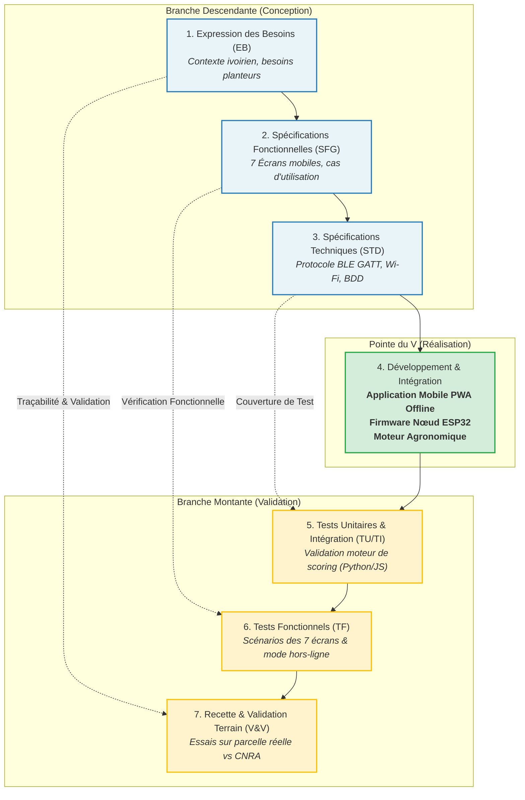
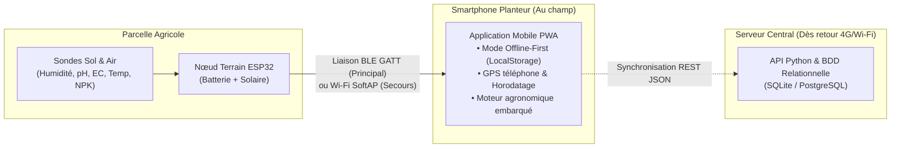

# Système d'Automatisation de Mesures des Besoins des Plantes pour l'Adaptation des Cultures de Base aux Terres Agricoles Ivoiriennes

[](docs/00_demarche_cycle_en_v.md)
[-2d7a4f.svg)](https://inphb.ci)
[]()
[-success.svg)]()

> **Projet d'Ingénierie (UP Projet - 1ère Année Ingénieur)**  
> **Encadrant :** M. DIOMANDE SAHI ROLAND  
> **Participants :** ALI KOUAKOU ANGE PARFAIT N. (STGI)
>                 ** ANDIETTY KOBENAN J. ISIDORE (STIC)
>                 ** KOUSSOUBE DAOUDA (STIC)
>                 ** SERI KOUBI GNAHOUA JUNIOR (STGI)
>                 ** TRAORE DJIBRIL ZANA (STGI)
> **Référentiel agronomique :** FAO EcoCrop & fiches techniques CNRA / ANADER (Côte d'Ivoire)

---

## 1. Contexte et Problématique

En Côte d'Ivoire, les choix culturaux et les apports en eau et en amendements reposent encore très largement sur des pratiques empiriques. Or, les terres arables ivoiriennes présentent une forte variabilité selon les zones pédoclimatiques :
- **Sud forestier et Centre de transition (ex. Yamoussoukro)** : forte acidité fréquente ($pH < 5.5$), lessivage des cations, carences minérales.
- **Nord de savane** : déficit hydrique prononcé lors de la saison sèche et harmattan.

**La solution développée :** Un système cyber-physique complet associant un **nœud terrain autonome (ESP32 solaire)** et une **application mobile intelligente (Offline-First)** permettant de cartographier la fertilité d'une parcelle (Humidité, pH, Conductivité électrique EC, Température, NPK), d'évaluer l'adéquation de 6 cultures de base (*Igname, Maïs, Tomate, Manioc, Riz pluvial, Banane plantain*) et de fournir des conseils précis (chaulage, drainage, irrigation, fertilisation).

---

## 2. Démarche Méthodologique : Le Cycle en V

Le projet est rigoureusement conduit selon la méthodologie du **Cycle en V**, garantissant que chaque choix fonctionnel et technique est auditable, documenté et testable.



### Documentation Complète du Cycle en V
- [docs/00_demarche_cycle_en_v.md](file:///c:/Users/Strings/Desktop/UP%20PROJET/docs/00_demarche_cycle_en_v.md) : Guide méthodologique détaillé du Cycle en V.
- [docs/01_expression_des_besoins.md](file:///c:/Users/Strings/Desktop/UP%20PROJET/docs/01_expression_des_besoins.md) : Analyse des besoins et contraintes agronomiques ivoiriennes.
- [docs/02_specifications_fonctionnelles.md](file:///c:/Users/Strings/Desktop/UP%20PROJET/docs/02_specifications_fonctionnelles.md) : Cahier des charges fonctionnel et description des 7 écrans.
- [docs/03_specifications_techniques.md](file:///c:/Users/Strings/Desktop/UP%20PROJET/docs/03_specifications_techniques.md) : Protocoles BLE GATT, Wi-Fi SoftAP, BDD relationnelle et scoring.
- [docs/04_plan_de_tests_et_validation.md](file:///c:/Users/Strings/Desktop/UP%20PROJET/docs/04_plan_de_tests_et_validation.md) : Plan de tests (TU, TI, TF, Recette terrain).
- [docs/matrice_tracabilite_exigences.md](file:///c:/Users/Strings/Desktop/UP%20PROJET/docs/matrice_tracabilite_exigences.md) : Matrice de traçabilité Exigences ↔ Code ↔ Tests.

---

## 3. L'Application Mobile (Cœur du Système Terrain)

L'application mobile est une **Progressive Web App (PWA) Offline-First**, utilisable directement dans un navigateur mobile (Chrome, Safari), installable sur l'écran d'accueil d'un smartphone Android/iOS, ou packagable en APK natif.

### Les 7 Écrans Implémentés (Conformes aux Maquettes TDR)

```
[1. Accueil] ───> [2. Nouvelle Campagne] ───> [3. Mesure en Cours] ───> [4. Résultats]
 (Mes parcelles)   (Choix cultures)            (BLE / GPS / Direct)       (Scores & Conseils)
       │
       ├──> [5. Historique des Campagnes] (Revue des campagnes passées)
       ├──> [6. Détail d'une Parcelle] (Moyennes pédologiques consolidées)
       └──> [7. Wi-Fi de Secours & Nœud] (Bascule BLE / SoftAP / Simulateur)
```

1. **Accueil (Mes parcelles)** : Liste des parcelles enregistrées avec nombre de campagnes et bouton d'action rapide.
2. **Nouvelle campagne** : Sélection de la parcelle et choix multiple des cultures candidates parmi le catalogue.
3. **Mesure en cours** : Connexion en temps réel au nœud ESP32, affichage des métriques instantanées (Humidité % VWC, pH, EC µS/cm, Température °C), acquisition des coordonnées GPS smartphone et bouton d'enregistrement point par point.
4. **Résultats d'adéquation** : Score de compatibilité global, badges d'évaluation (*Adapté* en vert, *Possible avec corrections* en orange, *Non adapté* en rouge) et recommandations agronomiques explicites (ex: *« Sol trop acide : prévoir un chaulage dolomitique »*).
5. **Historique des campagnes** : Suivi chronologique complet de tous les relevés antérieurs avec accès aux fiches détaillées.
6. **Détail d'une parcelle** : Fiche récapitulative consolidée avec moyennes historiques de pH, humidité et conductivité.
7. **Wi-Fi de secours & Nœud** : Gestion de la connectivité (Bluetooth BLE, Wi-Fi SoftAP `NOEUD-SOL-01`, et simulateur ESP32 intégré).

### Simulateur ESP32 Intégré
L'application inclut un simulateur matériel autonome avec des profils de sols réels (*Sol équilibré*, *Sol ferrallitique acide*, *Sol de bas-fond gorgé d'eau*, *Sol sec*), permettant de valider l'ensemble des parcours et calculs même sans carte ESP32 physique connectée.

---

## 4. Architecture Technique & Matérielle



### Protocoles Sans-Fil Nœud ↔ Téléphone
- **Bluetooth Low Energy (Mode Principal)** :
  - Nom : `NOEUD-SOL-01`
  - Service UUID : `4fafc201-1fb5-459e-8fcc-c5c9c331914b`
  - Caractéristique Mesures : `beb5483e-36e1-4688-b7f5-ea07361b26a8`
- **Wi-Fi SoftAP (Mode de Secours & Configuration)** :
  - SSID : `NOEUD-SOL-01` (Pass: `agro12345`)
  - IP Passerelle : `192.168.4.1`
  - Endpoint REST : `GET http://192.168.4.1/api/data`

---

## 5. Structure du Dépôt Git

```
UP PROJET/
├── docs/                                  # Documentation d'ingénierie Cycle en V
│   ├── 00_demarche_cycle_en_v.md          # Guide méthodologique Cycle en V
│   ├── 01_expression_des_besoins.md       # Analyse des besoins & contexte ivoirien
│   ├── 02_specifications_fonctionnelles.md# SFG : 7 écrans & cas d'utilisation
│   ├── 03_specifications_techniques.md    # STD : protocoles, BDD, formules de scoring
│   ├── 04_plan_de_tests_et_validation.md  # Plan de tests (TU, TI, TF, Recette)
│   └── matrice_tracabilite_exigences.md   # Matrice de traçabilité des exigences
├── mobile-app/                            # Application Mobile (PWA Offline-First)
│   ├── index.html                         # Interface des 7 écrans
│   ├── css/
│   │   └── app.css                        # Design responsive & système visuel
│   ├── js/
│   │   ├── app.js                         # Contrôleur applicatif
│   │   ├── ble_service.js                 # Service Web Bluetooth LE
│   │   ├── wifi_service.js                # Service Wi-Fi SoftAP HTTP
│   │   ├── agronomy_engine.js             # Moteur de calcul agronomique FAO/CNRA
│   │   ├── storage_service.js             # Persistance locale hors-ligne
│   │   └── esp32_simulator.js             # Simulateur de capteurs sol/climat
│   ├── manifest.json                      # Configuration PWA
│   └── service-worker.js                  # Cache pour usage 100% hors-ligne
├── firmware/                              # Code embarqué ESP32
│   └── ESP32_Noeud_Fertilite/
│       ├── ESP32_Noeud_Fertilite.ino      # Firmware C++ (BLE GATT + SoftAP WebServer)
│       ├── config.h                       # Affectation des broches & UUIDs
│       └── README.md                      # Guide de téléversement
├── server-api/                            # API REST & Schéma BDD
│   ├── server.py                          # Serveur léger de synchronisation Python
│   ├── schema.sql                         # Schéma relationnel BDD Excel
│   └── fiches_cultures.json               # Fiches agronomiques CNRA/FAO
├── tests/                                 # Branche montante de validation
│   └── test_agronomy_scoring.py           # Tests unitaires du moteur de score
├── .gitignore                             # Fichiers exclus du versionnement
└── README.md                              # Ce guide principal
```

---

## 6. Guide de Démarrage Rapide

### 1. Tester l'Application Mobile Immédiatement
Ouvrez simplement le fichier `mobile-app/index.html` dans votre navigateur Web (Chrome, Edge ou Safari) :
- Vous pouvez ouvrir directement :
  `file:///c:/Users/Strings/Desktop/UP%20PROJET/mobile-app/index.html`
- Ou lancer un serveur local avec Python :
  ```powershell
  python -m http.server 8080 --directory mobile-app
  ```
  Puis ouvrez `http://localhost:8080` sur votre PC ou le navigateur de votre smartphone connecté au même réseau.

### 2. Exécuter les Tests Unitaires Automatisés
Pour vérifier la conformité des calculs agronomiques avec les formules de référence :
```powershell
python tests/test_agronomy_scoring.py
```

### 3. Lancer le Serveur API de Synchronisation (Optionnel)
```powershell
python server-api/server.py
```

---

## 7. Contacts & Remerciements

- **Établissement :** Institut National Polytechnique Félix Houphouët-Boigny (INP-HB) - Yamoussoukro
- **Écoles associées :** École Supérieure d'Industrie (ESI)
- **Partenaires scientifiques :** CNRA (Centre National de Recherche Agronomique) & ANADER
