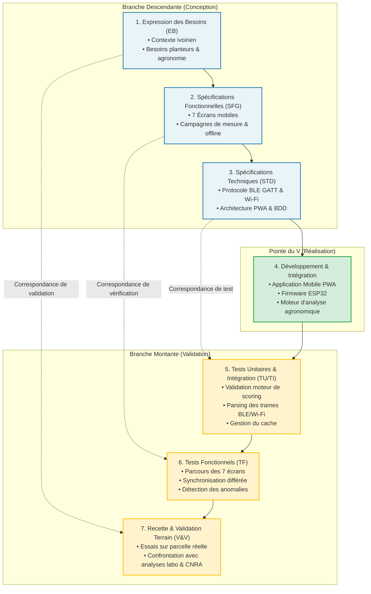

# Démarche Méthodologique : Le Cycle en V Appliqué au Projet

**Projet :** Conception et Réalisation d'un Système d'Automatisation de Mesures des Besoins des Plantes pour une Adaptation des Cultures de Base aux Terres Agricoles Ivoiriennes  
**Établissement :** Institut National Polytechnique Félix Houphouët-Boigny (INP-HB) - ESI  
**Filières :** STIC & STGI (Ingénieur 1ère année)  
**Encadrant :** M. DIOMANDE SAHI ROLAND  
**Chef de projet :** ALI KOUAKOU ANGE PARFAIT N.  

---

## 1. Pourquoi le Cycle en V ?

Le **Cycle en V** est une méthodologie d'ingénierie système et logicielle particulièrement adaptée aux projets mixtes (matériel électronique embarqué + logiciel mobile + agronomie) car il garantit :
1. **La rigueur de conception** : Chaque phase descendante de conception est associée à une phase montante de test et de validation symétrique.
2. **La traçabilité de bout en bout** : De l'expression du besoin de l'agriculteur ivoirien jusqu'à la recette sur la parcelle test.
3. **La réduction des risques de dérive** : Validation précoce des choix matériels (capteurs, énergie solaire, microcontrôleur) et logiciels (mode hors-ligne, BLE/Wi-Fi) avant le déploiement sur le terrain.

---

## 2. Diagramme Global du Cycle en V du Projet

---

## 3. Détail des Correspondances du Cycle en V

| Niveau de Conception (Descente) | Livrable Associé | Niveau de Validation (Remontée) | Objectif & Critère de Succès |
| :--- | :--- | :--- | :--- |
| **Expression des Besoins (EB)** | `docs/01_expression_des_besoins.md` | **Recette Terrain (V&V)** (`docs/04_plan_de_tests_et_validation.md`) | Valider que l'agriculteur obtient un diagnostic compréhensible et une recommandation fiable validée par le CNRA. |
| **Spécifications Fonctionnelles (SFG)** | `docs/02_specifications_fonctionnelles.md` | **Tests Fonctionnels (TF)** | Valider que les 7 écrans s'enchaînent sans accroc, que la capture GPS et le mode hors-ligne fonctionnent au champ. |
| **Spécifications Techniques (STD)** | `docs/03_specifications_techniques.md` | **Tests Unitaires & Intégration (TU/TI)** (`tests/test_agronomy_scoring.py`) | Valider la précision mathématique du moteur de règles, la robustesse du protocole BLE/Wi-Fi et l'intégrité de la BDD. |
| **Réalisation & Codage** | `mobile-app/`, `firmware/`, `server-api/` | **Revue de code & Métriques** | Code modulaire, documenté, responsive et testable immédiatement sur simulateur et sur appareil réel. |

---

## 4. Priorité Établie : L'Application Mobile

Conformément à la feuille de route :
- **L'application mobile** est le pivot opérationnel : c'est elle que manipule l'utilisateur au champ. Elle collecte les données du nœud ESP32 via BLE (avec secours Wi-Fi SoftAP), horodate et géolocalise les mesures, stocke les points dans son cache local hors-ligne, exécute le moteur agronomique d'adaptation du sol, et présente des recommandations lisibles.
- Elle intègre également un **simulateur ESP32 complet** pour permettre le développement et les tests fonctionnels complets sans dépendre de la disponibilité immédiate du matériel physique.
