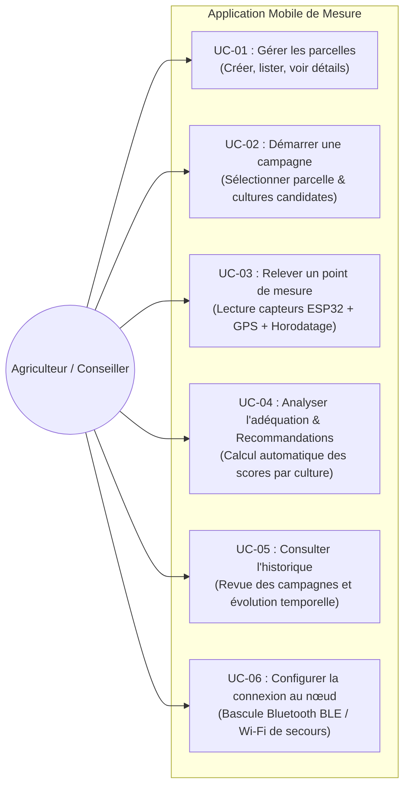

# 2. Spécifications Fonctionnelles Générales (SFG)

## 1. Cas d'Utilisation (Use Cases)

---

## 2. Description Détaillée des 7 Écrans de l'Application

L'ergonomie et l'architecture visuelle reprennent fidèlement les maquettes validées dans le document des Termes de Référence (`TDR_UP_Projet_Fertilite_Sol.pdf`) et le prototype HTML (`application_pages_mockup.html` & `application_pages_mockup_suite.html`).

### Écran 1 : Accueil (Mes Parcelles)
- **Objectif** : Point d'entrée de l'application. Offre une vue d'ensemble des terres gérées par le producteur.
- **Éléments d'interface** :
  - En-tête avec titre « Mes parcelles » et icône de localisation.
  - Cartes cliquables pour chaque parcelle enregistrée (ex. *Champ Nord*, *Champ Sud*) indiquant le nombre de campagnes de mesure déjà réalisées.
  - Bouton d'action principal bien visible : `+ Nouvelle campagne`.
  - Accès direct au menu de navigation (Historique, Paramètres de connexion nœud).

### Écran 2 : Nouvelle Campagne (Démarrage)
- **Objectif** : Configurer la session de mesure avant de commencer les prélèvements sur le terrain.
- **Éléments d'interface** :
  - Champ de saisie / sélection : Nom de la parcelle (ou création d'une nouvelle parcelle).
  - Sélecteur multi-choix sous forme de chips interactifs pour choisir les cultures candidates à évaluer : *Igname*, *Maïs*, *Tomate*, *Manioc*, *Riz pluvial*, *Banane plantain*.
  - Bouton de validation : `Démarrer la campagne`.
  - Initialisation de la session locale avec statut `en_cours`.

### Écran 3 : Mesure en Cours (Acquisition Temps Réel)
- **Objectif** : Assurer l'acquisition des données au niveau de chaque point de prélèvement sur la parcelle.
- **Éléments d'interface** :
  - Indicateur de statut de connexion matériel : `Connecté au nœud` (icône Bluetooth verte ou Wi-Fi active).
  - 4 cartes de métriques principales en temps réel :
    - **Humidité du sol** : valeur en `% VWC` (Volumetric Water Content).
    - **pH du sol** : valeur sans unité avec code couleur (rouge si trop acide, vert si neutre).
    - **Conductivité Électrique (EC)** : valeur en `µS/cm` (salinité et présence ionique).
    - **Température du sol** : valeur en `°C`.
    - *(Affichage étendu optionnel : N-P-K en mg/kg et Température/Humidité de l'air).*
  - Compteur de points : ex. `Point 4 enregistré` (ou nombre de points dans la campagne courante).
  - Position GPS acquise automatiquement depuis le smartphone (Latitude, Longitude, Précision).
  - Bouton d'action : `Enregistrer le point` (stocke la mesure dans le cache local hors-ligne).
  - Bouton de fin : `Clôturer et analyser la campagne`.

### Écran 4 : Résultats (Diagnostic & Recommandations Agronomiques)
- **Objectif** : Présenter la synthèse agronomique et orienter le choix de l'agriculteur dès la fin des mesures.
- **Éléments d'interface** :
  - En-tête avec nom de la parcelle analysée et rappel du nombre de points mesurés.
  - Liste des cultures candidates sélectionnées, triées par ordre de compatibilité décroissant :
    - Nom de la culture.
    - Badge d'état clair :
      - **Adapté** (vert) : sol naturellement propice à la culture.
      - **Possible avec corrections** (orange/jaune) : sol cultivable moyennant des amendements.
      - **Non adapté** (rouge) : contrainte sol bloquante (ex. humidité excessive pour le maïs ou trop acide).
    - Score d'adéquation global en pourcentage (ex. 91%).
  - Boîte d'explications et recommandations opérationnelles :
    - Diagnostic explicite : ex. *« Sol acide (pH moyen = 5.65) : prévoir un chaulage dolomitique »*, *« Humidité excessive pour le maïs : prévoir un drainage »*.

### Écran 5 : Historique des Campagnes
- **Objectif** : Permettre à l'utilisateur et au conseiller agricole de consulter l'antériorité des relevés sur ses parcelles.
- **Éléments d'interface** :
  - Liste chronologique des campagnes passées.
  - Pour chaque campagne : Nom de la parcelle, date de réalisation, statut (`Analysée`, `En cours`), cultures testées.
  - Clic sur une ligne permettant de ré-ouvrir immédiatement la fiche complète des résultats et des mesures point par point.

### Écran 6 : Détail d'une Parcelle
- **Objectif** : Offrir une fiche d'identité pédologique synthétique d'une parcelle à partir de toutes les campagnes effectuées.
- **Éléments d'interface** :
  - Nom et localisation de la parcelle.
  - Résumé de la dernière campagne : date et nombre de points relevés.
  - Moyennes historiques consolidées : pH moyen, Humidité moyenne, Conductivité moyenne.
  - Historique des cultures candidates déjà évaluées.
  - Bouton d'action rapide : `Nouvelle campagne ici`.

### Écran 7 : Wi-Fi de Secours & Connexion au Nœud
- **Objectif** : Gérer la connectivité avec le boîtier de mesure et assurer la résilience si le Bluetooth est indisponible.
- **Éléments d'interface** :
  - Sélecteur de mode de communication :
    - **Bluetooth BLE** (mode nominal par défaut pour les relevés au champ).
    - **Wi-Fi SoftAP** (mode de secours lorsque le BLE n'est pas supporté ou pour diagnostic).
  - Affichage des informations du réseau du boîtier : SSID `NOEUD-SOL-01`, IP passerelle `192.168.4.1`.
  - Bouton de synchronisation manuelle vers le serveur central (dès que le téléphone capte le réseau Internet 4G ou Wi-Fi domestique).
  - Mode simulateur interactif pour démonstration et tests sans matériel.

### Écran 8 (Portail Web Superviseur) : Tableau de Bord & Gestion BDD
- **Objectif** : Outil de supervision globale pour les enseignants, chercheurs et jury de soutenance.
- **Fonctionnalités** :
  - **KPIs en temps réel** : Total planteurs, parcelles actives, campagnes clôturées, points de prélèvement.
  - **Graphiques analytiques** : Évolution temporelle, distribution physico-chimique (pH vs humidité), taux d'adéquation globale des cultures, adhésion par localité.
  - **Gestion dynamique des cultures (CRUD)** : Ajout / édition / suppression de cultures cibles (ex: cacao, anacarde, piment) avec mise à jour immédiate du moteur agronomique mobile.
  - **Explorateur de données géographiques** : Consultation de chaque point relevé avec coordonnées GPS et paramètres NPK.
  - **Exportation / Restauration** : Sauvegarde JSON/CSV de toute la base de données.

---

## 3. Exigences Non-Fonctionnelles

1. **Architecture Offline-First (Hors-ligne d'abord)** : Toutes les opérations de création de campagne, relevé de points, calcul de score agronomique et consultation de l'historique doivent fonctionner **sans aucune connexion Internet**.
2. **Temps de Réponse & Réactivité** : L'acquisition d'un point et l'affichage des valeurs doivent s'effectuer en moins de 500 ms.
3. **Consommation Énergétique Smartphone** : Utilisation efficiente du BLE pour préserver la batterie du smartphone lors des campagnes prolongées au soleil.
4. **Accessibilité & Simplicité Visuelle** : Police lisible sous forte luminosité solaire, contraste élevé, utilisation de pictogrammes universels.
