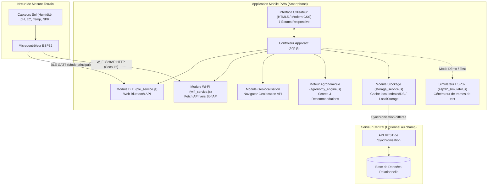
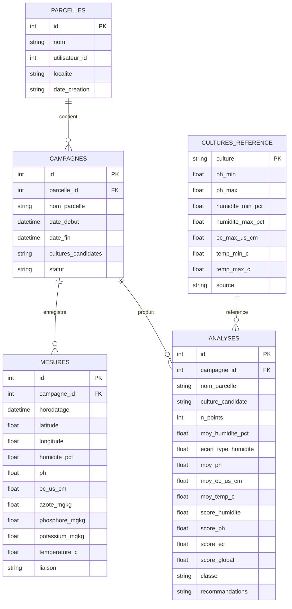

# 3. Spécifications Techniques Détaillées (STD)

## 1. Architecture Logicielle Globale

L'application mobile est conçue selon le paradigme **Progressive Web App (PWA) Offline-First**, permettant une exécution immédiate sur tout smartphone moderne (Android, iOS via Safari/Chrome) ou sur ordinateur portable, tout en offrant la possibilité d'un empaquetage natif (via Apache Cordova ou Capacitor) pour générer un APK Android.



---

## 2. Protocoles de Communication avec le Nœud ESP32

### 2.1 Liaison Nominale : Bluetooth Low Energy (BLE)
Le microcontrôleur ESP32 agit en tant que **Serveur GATT (Peripheral)**. L'application mobile smartphone agit en tant que **Client GATT (Central)** via l'API standardisée `navigator.bluetooth`.

- **Service UUID** : `4fafc201-1fb5-459e-8fcc-c5c9c331914b` (Service Fertilité Sol)
- **Caractéristique Données Capteurs (Lecture / Notification)** :
  - **UUID** : `beb5483e-36e1-4688-b7f5-ea07361b26a8`
  - **Propriétés** : `READ`, `NOTIFY`
  - **Format du payload (JSON encodé en UTF-8)** :
    ```json
    {
      "humidity": 25.4,
      "ph": 6.12,
      "ec": 980,
      "temp": 26.8,
      "nitrogen": 18,
      "phosphorus": 12,
      "potassium": 65,
      "battery": 94,
      "timestamp": 1729227600
    }
    ```

### 2.2 Liaison de Secours : Wi-Fi SoftAP (Point d'Accès Embarqué)
Lorsque le smartphone ne supporte pas le Web Bluetooth ou en environnement perturbé :
- L'ESP32 diffuse son propre réseau Wi-Fi local :
  - **SSID** : `NOEUD-SOL-01`
  - **Clé WPA2** : `agro12345` (ou réseau ouvert pour configuration rapide)
  - **Adresse IP du nœud** : `192.168.4.1`
- L'application interroge le nœud par des requêtes HTTP REST :
  - `GET http://192.168.4.1/api/data` : Renvoie l'état instantané des capteurs au format JSON.
  - `GET http://192.168.4.1/api/status` : Renvoie la santé de la batterie solaire et le temps d'activité.

---

## 3. Schéma de Base de Données Relationnelle

Le modèle de données local et serveur implémente fidèlement les spécifications du fichier de référence `BDD_Dispositif_Fertilite_Sol.xlsx`.



---

## 4. Algorithme du Moteur d'Adéquation Agronomique

Pour une campagne de mesure comptant $N$ points de prélèvement sur une parcelle :

### Étape 1 : Calcul des moyennes consolidées
$$\bar{H} = \frac{1}{N} \sum_{i=1}^N \text{humidite}_i, \quad \bar{pH} = \frac{1}{N} \sum_{i=1}^N \text{ph}_i, \quad \bar{EC} = \frac{1}{N} \sum_{i=1}^N \text{ec}_i, \quad \bar{T} = \frac{1}{N} \sum_{i=1}^N \text{temp}_i$$

### Étape 2 : Évaluation des scores individuels par paramètre $p$
Pour chaque culture candidate $C$ disposant de la plage optimale $[p_{min}, p_{max}]$ :
- **Humidité ($S_H$)** :
  - Si $\bar{H} \in [H_{min}, H_{max}]$ : $S_H = 1.0$
  - Si $\bar{H} < H_{min}$ : $S_H = \max(0, 1 - \frac{H_{min} - \bar{H}}{H_{min}})$ (déficit hydrique)
  - Si $\bar{H} > H_{max}$ : $S_H = \max(0, 1 - \frac{\bar{H} - H_{max}}{100 - H_{max}})$ (excès d'eau / asphyxie)
- **pH ($S_{pH}$)** :
  - Si $\bar{pH} \in [pH_{min}, pH_{max}]$ : $S_{pH} = 1.0$
  - Si écart $\le 0.5$ unité : $S_{pH} = 0.5$ (acidité ou alcalinité modérée)
  - Si écart $> 0.5$ unité : $S_{pH} = 0.0$ (stress édaphique sévère)
- **Conductivité Électrique ($S_{EC}$)** :
  - Si $\bar{EC} \le EC_{max}$ : $S_{EC} = 1.0$
  - Si $\bar{EC} > EC_{max}$ : $S_{EC} = \max(0, 1 - \frac{\bar{EC} - EC_{max}}{EC_{max}})$

### Étape 3 : Score Global Pondéré et Classification
$$Score_{\text{global}} = \frac{w_H \cdot S_H + w_{pH} \cdot S_{pH} + w_{EC} \cdot S_{EC}}{w_H + w_{pH} + w_{EC}}$$
*(Avec $w_{pH} = 2.0$, $w_H = 2.0$, $w_{EC} = 1.0$)*

- **Classification** :
  - $Score_{\text{global}} \ge 0.80$ : **Adapté**
  - $0.50 \le Score_{\text{global}} < 0.80$ : **Possible avec corrections**
  - $Score_{\text{global}} < 0.50$ : **Non adapté**

### Étape 4 : Génération des Recommandations Opérationnelles
- Si $\bar{pH} < pH_{min}$ : *"Sol trop acide (pH mesuré $\bar{pH}$, min conseillé $pH_{min}$) : prévoir un amendement basique (chaulage dolomitique)."*
- Si $\bar{H} < H_{min}$ : *"Déficit hydrique (humidité $\bar{H}\%$, min conseillé $H_{min}\%$) : irriguer ou pailler le sol."*
- Si $\bar{H} > H_{max}$ : *"Sol trop humide / risque d'asphyxie (humidité $\bar{H}\%$, max conseillé $H_{max}\%$) : favoriser le drainage ou billonner."*
- Si $\bar{EC} > EC_{max}$ : *"Salinité élevée (EC = $\bar{EC}\,\mu\text{S/cm}$) : risque d'inhibition racinaire, lessivage recommandé."*
- Si aucun écart majeur : *"Sol adapté, aucun apport correctif lourd nécessaire."*
